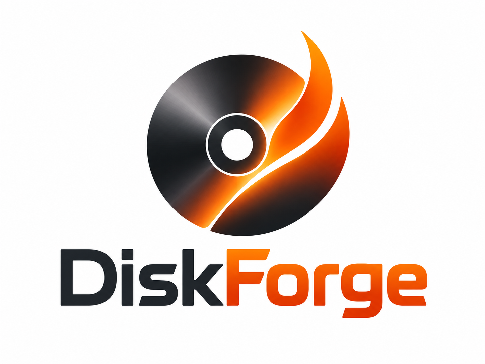
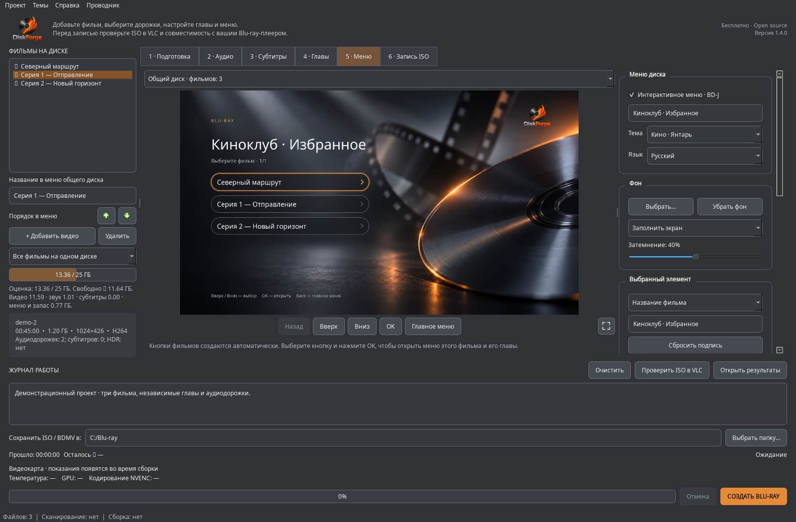
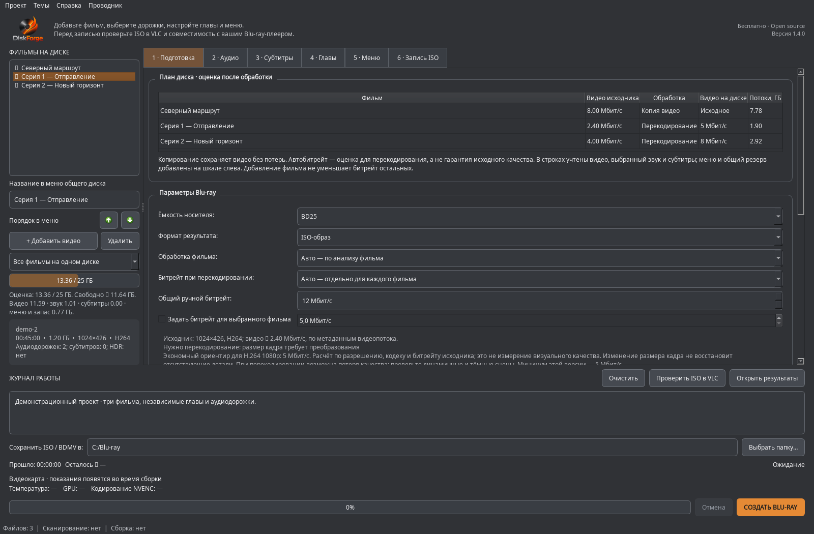
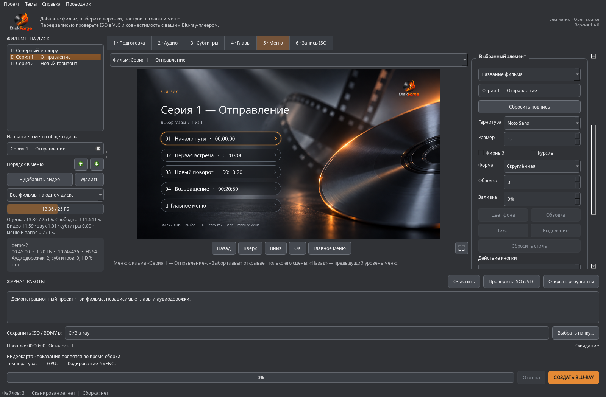

# DiskForge 1.4.0



**Ваша коллекция. Ваши дорожки. Ваше меню. Готовый Blu-ray ISO.**

Бесплатное приложение для Windows 10/11 x64: объединяет фильмы и серии на BD25/BD50, создаёт интерактивное меню, главы и переключаемые аудиодорожки и субтитры. Совместимое видео можно сохранить без перекодирования. Всё обрабатывается локально, без аккаунта.

[Скачать 1.4.0](https://github.com/maxliv234-star/DiscForge-RU/releases/tag/v1.4.0) · [Что нового](docs/RELEASE_1.4.0.md) · [Руководство](docs/USER_GUIDE.md) · [Roadmap](docs/ROADMAP.md) · [Сообщить об ошибке](https://github.com/maxliv234-star/DiscForge-RU/issues)



*Снимки настоящего интерфейса с демонстрационным проектом; параметры примеров не описывают пользовательские файлы.*

## Начать работу

1. Распакуйте **всю папку** `DiscForge-RU-1.4.0-Windows-x64.zip` и запустите `DiscForge_RU.exe`. Инструменты и отдельная Java уже в комплекте; VLC устанавливается отдельно.
2. Добавьте фильмы, дождитесь анализа и выберите общий диск либо отдельный диск для каждого фильма.
3. В «Подготовке» проверьте план: копирование или перекодирование, индивидуальные битрейты и заполнение BD25/BD50. Автоподбор включён в новых проектах; старые настройки сохраняются.
4. Выберите звук, субтитры и главы для каждого фильма. Отредактируйте названия и порядок фильмов, оформите меню.
5. Укажите папку результата и создайте ISO. Проверьте его кнопкой «Проверить ISO в VLC», затем запишите через ImgBurn или другую программу записи образов.

## Главное в 1.4

| Возможность | Как работает |
|---|---|
| Общий диск | До 99 фильмов, страницы каталога, независимые главы и дорожки; переименование и порядок кнопок |
| Автоподбор битрейта | Отдельная рекомендация по разрешению, кодеку и видеобитрейту; ручные поправки |
| Контроль размера | Видео, выбранный звук, субтитры, меню и запас; предупреждение от 90%, отказ при переполнении |
| Сохранение качества | Копирование проверенного совместимого видео; независимая обработка аудиодорожек |
| TrueHD/Atmos | Сохранение TrueHD, совместимый AC-3 слой, выбор в меню; побитная проверка |
| Возобновление | Кэш завершённых этапов с SHA-256; повторное создание ISO без нового кодирования |
| NVIDIA | NVDEC/CUDA/NVENC, проверка доступности, температура и загрузка, предупреждение о нагреве |
| Проверка ISO | Связи меню/MPLS/глав/дорожек, UDF и содержимое образа; отдельный прогресс, скорость, ETA и отчёт |
| Оформление | «Кино · Янтарь» и «Кино · Сапфир», свой фон, удаляемый логотип, полный экран и правая панель |
| Проводник | «Открыть Blu-ray в VLC» с правильным режимом и комплектной Java |



Автоподбор помогает избежать неоправданно большого файла, но не измеряет визуальное качество. **Перекодирование не гарантирует отсутствие потерь.** Совместимые копируемые потоки не уменьшаются ради заполнения общего диска. Если места не хватает, программа объясняет причину. [Расчёт битрейта](docs/BITRATE.md) · [Коллекции и место](docs/COLLECTIONS.md).

## Меню, главы, звук и субтитры

Каждый фильм получает свою кнопку и своё меню. Тайминги и названия сцен импортируются из MKV; их можно исправлять. Название фильма видно на странице глав. Пульт выбирает фильм, главу, озвучку и субтитры; Pop-up Menu позволяет менять дорожки во время просмотра.

Один щелчок выбирает элемент, перетаскивание перемещает, маркеры меняют размер. Двойной щелчок редактирует текст, Del удаляет объект. Доступны шрифты, цвет, заливка, форма кнопок, обводка, направляющие и свой фон. Интерфейс — графитовый или синий; язык меню — русский или английский.



[Аудио](docs/AUDIO.md) · [TrueHD/Atmos](docs/TRUEHD.md) · [Субтитры](docs/SUBTITLES.md) · [Возобновление, GPU и проверки](docs/LOCAL_ENGINE.md).

## Обновление проектов и ISO

Проекты прежних версий открываются с прежними настройками. Чтобы включить новые рекомендации, нажмите «Применить автоподбор ко всем фильмам». Это сбрасывает ручные битрейты и выбирает сбалансированный кодер.

Меню собственного ISO **с одним фильмом** можно заменить без изменения M2TS, MPLS и CLPI. Получается новый образ; исходный сохраняется. Для коллекции откройте проект и повторите сборку: проверенные видео и аудио будут использованы из кэша. Прямая правка многотитульного ISO ещё в Roadmap.

## Границы и проверка

Авторинг ориентирован на обычный Full HD Blu-ray. HDR/UHD/4K, DTS-HD и E-AC-3/Atmos passthrough, полноценное оформление ASS/SSA и встроенная запись болванок пока отсутствуют. Поддерживаемые варианты AC-3, DTS core, LPCM и TrueHD описаны в руководстве. Оценка размера предварительная, фактический размер тоже проверяется.

Автотесты и короткие реальные медиа-сценарии проверяют конвейер; BD-J проверялся в VLC. Это не подтверждает все бытовые плееры, HDMI bitstream или сертификацию Blu-ray. [Матрица физических испытаний](docs/PLAYER_TEST_MATRIX.md) остаётся открытой. Windows-пакет не подписан; macOS — [экспериментальное направление](docs/MACOS.md).

## Для разработчиков

Python 3.11+, PySide6 Essentials 6.8.3. Активируйте виртуальное окружение:

```sh
python -m pip install -r requirements.txt
python main.py
python -m unittest discover -s tests -v
```

CLI для отдельного фильма:

```sh
python cli.py probe film.mkv
python cli.py build film.mkv --processing auto --audio-track 1 --menu-title "Мой фильм" --output Ready
```

`--audio-track` — глобальный индекс потока из анализа. Новый план коллекции и индивидуальный автоподбор настраиваются в GUI. [Сборка и публикация](PUBLISH_GITHUB.md) · [Архитектура BD-J](docs/BDJ_AUTHORING.md) · [Вся документация](docs/README.md).

Исходники приложения и Xlet — [MIT](LICENSE). Qt, Java, FFmpeg, tsMuxer и шрифты имеют отдельные лицензии: [Third-party notices](THIRD_PARTY_NOTICES.md). Программа не снимает DRM. Для ошибки приложите версию, шаги, журнал и сведения о потоках без личных путей; сам фильм присылать не нужно.
