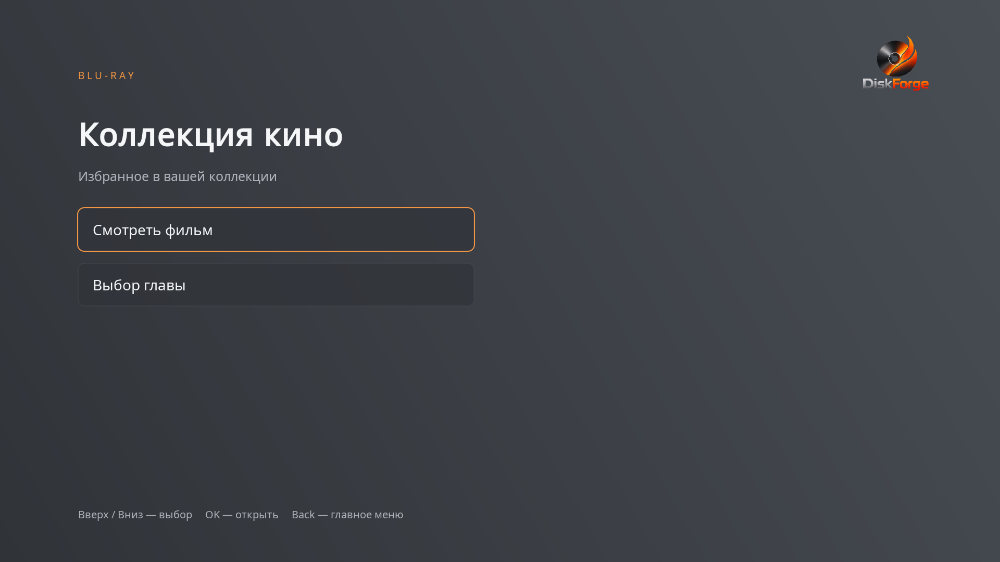
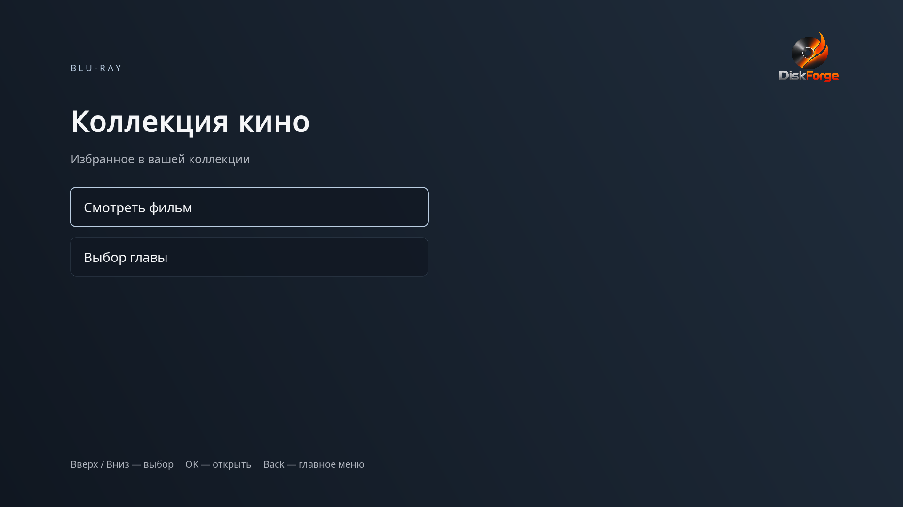

# DiscForge RU 1.1

**Фильм. Ваши дорожки. Ваше меню. Готовый Blu-ray ISO.**

Бесплатное приложение для Windows 10/11 x64: создаёт Full HD Blu-ray BD25/BD50 с интерактивным меню, главами и выбранными аудиодорожками. Подходящее видео можно сохранить без перекодирования и потери качества.

[Скачать 1.1](https://github.com/maxliv234-star/DiscForge-RU/releases/tag/v1.1.0) · [Руководство](docs/USER_GUIDE.md) · [Документация](docs/README.md) · [Roadmap](docs/ROADMAP.md) · [Сообщить об ошибке](https://github.com/maxliv234-star/DiscForge-RU/issues)



## Быстрый старт

1. Скачайте `DiscForge-RU-1.1.0-Windows-x64.zip` из релиза, распакуйте **всю папку** и запустите `DiscForge_RU.exe`.
2. Добавьте фильм и дождитесь анализа. Во вкладке **Подготовка** оставьте «Авто» или выберите рекомендованный режим.
3. В разделе **Аудио** отметьте дорожки для ISO. В разделе **Главы** добавьте нужные тайминги.
4. В разделе **Меню** выберите тему или своё изображение, разместите текст и кнопки.
5. Выберите выходную папку и **ISO**, нажмите **Создать Blu-ray**. После завершения нажмите **Проверить ISO в VLC**.
6. Запишите проверенный ISO через ImgBurn или системную программу записи. Перед записью на BD-R проверьте меню и звук в плеере.

Portable-сборка содержит FFmpeg, ffprobe, tsMuxer и отдельную Java 8 x64 для проверки меню. Python и системная Java не нужны. VLC x64 устанавливается отдельно. Не переносите один EXE отдельно от остальных файлов. Сборка не имеет цифровой подписи.

## Что входит в 1.1

- Раздел «Аудио» на самом диске: язык и название озвучки, выбор стрелками и OK. Pop-up Menu позволяет сменить звук во время фильма.

| Раздел | Возможности |
|---|---|
| Подготовка | Очередь фильмов, BD25/BD50, анализ и рекомендация, выбор выходной папки |
| Обработка | Авто, копирование потоков, копирование видео с преобразованием звука, полное перекодирование; CPU x264 / NVIDIA NVENC |
| Аудио | Все обнаруженные дорожки с языком, кодеком и числом каналов; независимые галочки для каждого фильма; сохранение выбора в проекте |
| Главы | Добавление и правка времени, автоматический интервал, переходы на диске |
| Меню | Спокойная тёмная тема и серая «Графит», сохранённая тема «Кинотеатр», свой фон, русский/английский текст, кнопки и действия |
| Редактор | Щелчок — выделить; перетаскивание — переместить; двойной щелчок — редактировать; Del — удалить; маркеры — размер; мягкие направляющие |
| Оформление | Шрифты, размер и цвет любого текста; форма, фон, прозрачность, обводка и выделение кнопок |
| Предпросмотр | Навигация меню, полный экран F11, запуск готового ISO в VLC с комплектной Java |
| Готовый ISO | Загрузка и замена меню без перекодирования и повторного мультиплексирования фильма, исправление старой обводки |
| Сборка | Прогресс, прошедшее время, оценка оставшегося времени, отмена, структурные проверки BDMV и UDF 2.50 |



## Видео и звук без перекодирования

Анализ проверяет весь поток, временные метки, SPS/PPS, HRD, разрешение и частоту. Поддерживаемый набор для копирования: AVC/H.264 Main/High до 4.1, 8 бит 4:2:0, прогрессивные 1080p 23,976/24 либо 720p 23,976/24/50/59,94. Проверяются также ёмкость диска и суммарный битрейт выбранных потоков. Это консервативная проверка: некоторые воспроизводимые файлы могут получить рекомендацию перекодировать.

По умолчанию выбрана первая аудиодорожка; можно выбрать другие, несколько или ни одной. Совместимые AC-3 48 кГц до 640 кбит/с и 6 каналов копируются. Другие выбранные дорожки преобразуются в AC-3, до 5.1. В смешанном наборе совместимый AC-3 сохраняется, преобразуются только остальные дорожки. Полное перекодирование преобразует видео и все выбранные аудиодорожки. Подробности — [Аудио](docs/AUDIO.md).

При полном перекодировании результат — H.264 1920×1080, 23,976 fps, AC-3 48 кГц. Доступны быстрый и сбалансированный режимы. Изменение исходной частоты кадров может влиять на плавность. NVENC проверяется реальным коротким кодированием; при недоступном драйвере «Авто» использует CPU.

## Обновление меню готового ISO

В **Запись ISO** выберите образ DiscForge → **Загрузить меню из ISO** → отредактируйте → **Сохранить текущее меню в ISO…**. Видео, звук, главы и клипы остаются побайтно прежними. Создаётся новый файл; исходный ISO не перезаписывается. Скорость зависит от чтения и записи полного объёма образа, но кодирование не выполняется.

Поддерживаются собственные ISO UDF 2.50 с одним фильмом, плейлистом `00000` и BD-J. Редактируемые настройки встроены начиная с 0.9. Для старых ISO можно исправить обводку без проекта; для изменения надписей нужен сохранённый проект или новое меню. [Подробная инструкция](docs/USER_GUIDE.md#изменение-меню-готового-iso).

## Границы версии 1.1

Один фильм на диск; очередь создаёт отдельный диск для каждого фильма. Субтитры, сохранение DTS/TrueHD/LPCM, HDR/UHD/4K, несколько фильмов на одном диске пока не реализованы. Аудиодорожки выбираются в разделе «Аудио» дискового меню. Во время фильма Pop-up Menu открывает выбор звука с паузой; после выбора или Back просмотр продолжается. Сохранение позиции между сеансами пока не поддерживается.

Выпуск 1.1 — для Windows x64. macOS остаётся [экспериментальным направлением](docs/MACOS.md). Структурные тесты и загрузка BD-J в VLC не означают сертификацию Blu-ray или совместимость со всеми бытовыми устройствами. Аппаратные тесты разных плееров и физической записи остаются в Roadmap.

## Для разработчиков

Python 3.11+; проверенная GUI-зависимость — PySide6 Essentials 6.8.3.

```sh
python -m venv .venv
python -m pip install -r requirements.txt
python main.py
python -m unittest discover -s tests -v
```

Используйте Python активированного окружения. FFmpeg/ffprobe/tsMuxer укажите в «Подготовка». Готовый Xlet и шрифты включены в исходники; Java не требуется для сборки меню. Для просмотра через VLC из исходников разместите Java 8 x64 JRE с лицензиями в `runtime/java`.

```sh
python cli.py probe film.mkv
python cli.py build film.mkv --processing auto --audio-track 1 --audio-track 2 --menu-title "Мой фильм" --menu-theme graphite --output Ready
```

`--audio-track` использует глобальный `index` из `probe`. `--no-audio` создаёт диск без звука. Пути к инструментам задаются аргументами `--ffmpeg`, `--ffprobe`, `--tsmuxer`.

[Сборка и выпуск](PUBLISH_GITHUB.md) · [Проверки 1.1](docs/RELEASE_1.1.md) · [Архитектура BD-J](docs/BDJ_AUTHORING.md)

## Лицензии и участие

Исходники приложения и Xlet — [MIT](LICENSE). Компоненты Qt, Java, FFmpeg, tsMuxer и шрифты имеют отдельные лицензии: [Third-party notices](THIRD_PARTY_NOTICES.md). Используйте свои материалы или материалы, на обработку которых у вас есть права. Программа не снимает DRM.

Для сообщения об ошибке приложите версию, шаги воспроизведения, журнал и сведения `ffprobe` без личных путей. Не прикладывайте сам фильм. Предложения и pull request приветствуются; приоритеты — в Roadmap.
