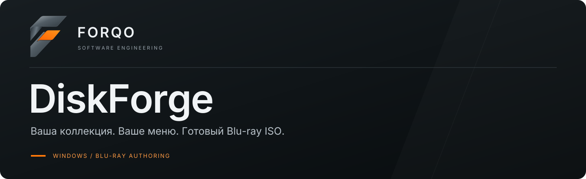
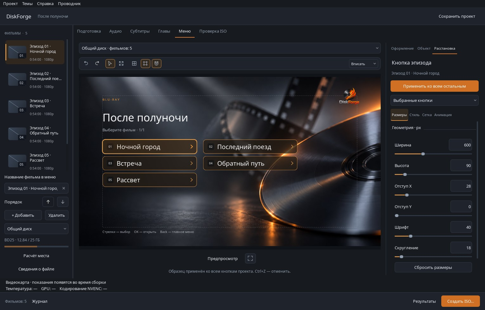
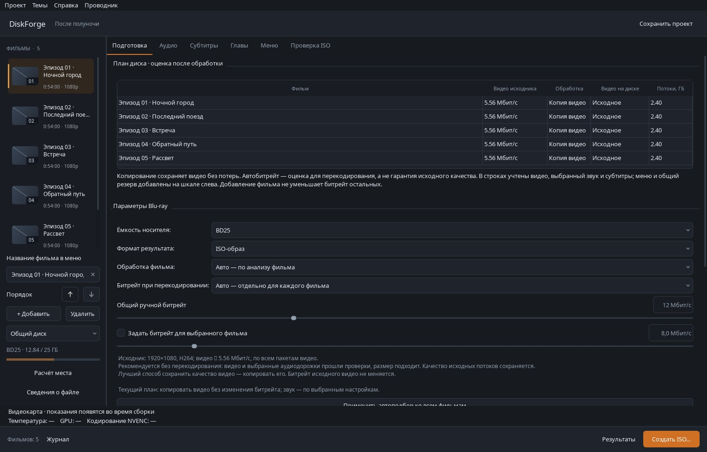
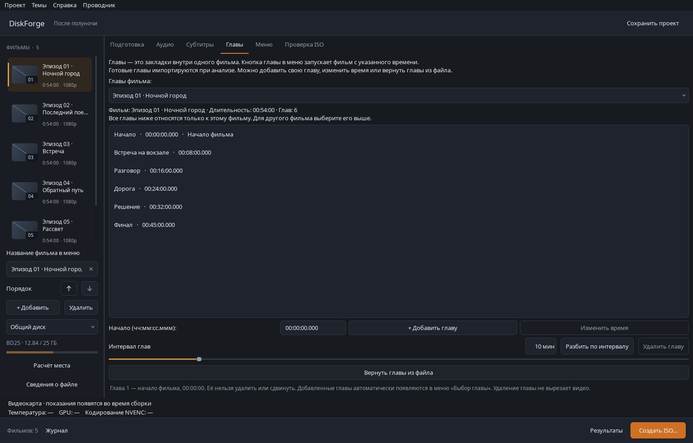

<p align="center">
  
</p>

<p align="center"><b>Фильмы и серии на одном Blu-ray: меню, главы, звук и субтитры.</b></p>

<p align="center"><a href="#быстрый-старт">Быстрый старт</a> · <a href="#возможности">Возможности</a> · <a href="docs/README.md">Документация</a> · <a href="#разработка">Разработка</a> · <a href="https://github.com/FORQO/DiscForge-RU/releases/tag/v1.5.1-studio">Windows</a> · <a href="https://github.com/FORQO/DiscForge-RU/releases/tag/v1.5.1-studio">macOS Studio</a></p>

| Платформа / направление | Статус | Технологии |
| :--- | :--- | :--- |
| Windows 10/11 x64 | [Studio 1.5.1 · готовый ZIP](https://github.com/FORQO/DiscForge-RU/releases/tag/v1.5.1-studio) | Python · PySide6 · FFmpeg |
| macOS · Apple Silicon (M1 и новее) | [Studio 1.5.1 · готовое приложение .app](https://github.com/FORQO/DiscForge-RU/releases/tag/v1.5.1-studio) | Python · PySide6 · FFmpeg · UDF 2.50 |

---

## О проекте

Бесплатное приложение для Windows и macOS: объединяет фильмы и серии на BD25/BD50, создаёт интерактивное меню, главы и переключаемые аудиодорожки и субтитры. Совместимое видео можно сохранить без перекодирования. Всё обрабатывается локально, без аккаунта.

[Что нового в Studio](docs/STUDIO.md) · [Руководство](docs/USER_GUIDE.md) · [Roadmap](docs/ROADMAP.md)

**Studio 1.5.1: единое оформление всего меню одним нажатием, удобное редактирование глав и обновлённые числовые настройки. Физическая проверка диска на GIEC G2805 прошла успешно — результат подтверждён автором проекта 9 ноября 2026 года.** [Что нового](docs/RELEASE_STUDIO_1.5.1.md) · [Физическая проверка](docs/PLAYER_TEST_MATRIX.md).

Сохранены [пробы качества, сложные сцены, VMAF/SSIM и подбор битрейта](docs/QUALITY_TRIAL.md), [бережное улучшение отдельно для каждого фильма и сравнение до/после](docs/VIDEO_ENHANCEMENT.md). Четыре стрелки в предпросмотре и BD-J выбирают ближайшую кнопку в указанном направлении.

**DiskForge Studio для Windows и macOS** — большая область меню, библиотека фильмов слева, свойства справа. Светлая и тёмная темы, отдельный режим предпросмотра и окно экспорта; журнал свёрнут до необходимости. Python, Qt, FFmpeg, tsMuxer и Java входят в приложение.

[Редактор кнопок](docs/EPISODE_BUTTONS.md): настройте одну кнопку и нажмите «Применить ко всем остальным». Оформление, размеры и равномерная расстановка распространяются на весь проект — фильмы, главы, звук, субтитры и навигацию. Подписи и действия сохраняются, весь шаг отменяется одним Ctrl+Z. Четыре стиля, свои пресеты, колонка, сетка и свободная расстановка доступны в редакторе. Анимации работают в предпросмотре; BD-J сохраняет статичные состояния с тем же оформлением.

[Обновлённый дизайн студии](docs/STUDIO_DESIGN.md): четыре компактных раздела свойств, карточки стилей, панель инструментов холста, отдельные номера эпизодов и фоновые миниатюры фильмов.



*Свежие снимки Studio 1.5.1 сняты на Windows с демонстрационным проектом. Интерфейс приложения настоящий; фильмы и названия в примере демонстрационные. macOS использует тот же редактор, системные шрифты и оформление окна могут отличаться.*

[Светлая тема](docs/images/studio-1.5.1-light.jpg) · [Предпросмотр с пультом](docs/images/studio-1.5.1-preview.jpg) · [Устройство интерфейса](docs/STUDIO_DESIGN.md).

## Быстрый старт

### Windows · Studio

1. Распакуйте **всю папку** `DiskForge-Studio-1.5.1-Windows-x64.zip` и запустите `DiscForge_RU.exe`. Инструменты и отдельная Java уже в комплекте; VLC устанавливается отдельно. В Studio настройки меню разделены на «Оформление», «Объект» и «Расстановка», пульт находится под изображением, журнал сворачивается.
2. Добавьте фильмы, дождитесь анализа и выберите общий диск либо отдельный диск для каждого фильма.
3. В «Подготовке» проверьте план: копирование или перекодирование, индивидуальные битрейты и заполнение BD25/BD50. Автоподбор включён в новых проектах; старые настройки сохраняются.
4. Выберите звук, субтитры и главы для каждого фильма. Отредактируйте названия и порядок фильмов, оформите меню.
5. Нажмите «Создать ISO…», выберите формат ISO/BDMV, носитель BD25/BD50 и папку результата. Проверьте его кнопкой «Проверить ISO в VLC», затем запишите через ImgBurn или другую программу записи образов.

### macOS · Studio

1. Скачайте [DiskForge-Studio-1.5.1-macOS-arm64.zip](https://github.com/FORQO/DiscForge-RU/releases/download/v1.5.1-studio/DiskForge-Studio-1.5.1-macOS-arm64.zip), распакуйте и перенесите `DiskForge.app` в «Программы».
2. Добавьте видео, выберите дорожки и главы, оформите меню. Справа доступны «Оформление», «Объект» и «Расстановка»; «Предпросмотр» показывает пульт под изображением.
3. Нажмите «Создать ISO…», выберите BD25/BD50, формат ISO/BDMV и папку результата. Python и Homebrew для запуска не требуются; VLC устанавливается отдельно.

Нужен Mac с Apple Silicon (M1 и новее). Приложение имеет локальную подпись, без нотарификации Apple. Если macOS блокирует запуск, откройте «Системные настройки → Конфиденциальность и безопасность → Всё равно открыть» для DiskForge.

[Релиз и контрольные суммы](https://github.com/FORQO/DiscForge-RU/releases/tag/v1.5.1-studio) · [Инструкция для Mac](docs/MACOS.md) · [Исходники Studio](https://github.com/FORQO/DiscForge-RU/tree/main).

## Возможности

| Возможность | Как работает |
|---|---|
| Общий диск | До 99 фильмов, страницы каталога, независимые главы и дорожки; переименование и порядок кнопок |
| Автоподбор битрейта | Первичный план по метаданным; пробы сложных сцен с VMAF/SSIM, уточнение и ручное применение |
| Улучшение фильма | Мягкое шумоподавление и резкость SDR, сравнение до/после; отдельный выбор для каждого фильма |
| Контроль размера | Видео, выбранный звук, субтитры, меню и запас; предупреждение от 90%, отказ при переполнении |
| Сохранение качества | Копирование проверенного совместимого видео; независимая обработка аудиодорожек |
| TrueHD/Atmos | Сохранение TrueHD, совместимый AC-3 слой, выбор в меню; побитная проверка |
| Возобновление | Кэш завершённых этапов с SHA-256; повторное создание ISO без нового кодирования |
| NVIDIA · Windows | NVDEC/CUDA/NVENC, проверка доступности, температура и загрузка, предупреждение о нагреве |
| Проверка ISO | Связи меню/MPLS/глав/дорожек, UDF и содержимое образа; отдельный прогресс, скорость, ETA и отчёт |
| Оформление | «Кино · Янтарь» и «Кино · Сапфир», свой фон, удаляемый логотип, полный экран и правая панель |
| Общий образец кнопок | Стиль, шрифт, размеры, отступы и сетка для всех страниц и фильмов; одна операция отмены |
| Редактор глав | Переименование двойным щелчком или F2; импорт из файла, ручное время и разбиение по интервалу |
| Проводник | «Открыть Blu-ray в VLC» с правильным режимом и комплектной Java |



Первичный план по метаданным помогает избежать неоправданно большого файла; «Проба качества» дополнительно измеряет VMAF/SSIM выбранных сцен. Выборочная оценка не гарантирует качество всего фильма. **Перекодирование не гарантирует отсутствие потерь.** Совместимые копируемые потоки не уменьшаются ради заполнения общего диска. Если места не хватает, программа объясняет причину. [Расчёт битрейта](docs/BITRATE.md) · [Коллекции и место](docs/COLLECTIONS.md).

## Меню, главы, звук и субтитры

Каждый фильм получает свою кнопку и своё меню. Тайминги и названия сцен импортируются из MKV. Во вкладке «Главы» двойной щелчок или F2 открывает название: Enter сохраняет, Esc отменяет. Время редактируется отдельно; поле интервала и соседние кнопки выровнены в одной строке. Название фильма видно на странице глав. Пульт выбирает фильм, главу, озвучку и субтитры; Pop-up Menu позволяет менять дорожки во время просмотра.

Один щелчок выбирает элемент, перетаскивание перемещает, маркеры меняют размер. Двойной щелчок редактирует текст, Del удаляет объект. Доступны шрифты, цвет, заливка, форма кнопок, обводка, направляющие и свой фон. В Studio для Windows и macOS доступны светлая и тёмная темы. Язык меню диска — русский или английский.



[Аудио](docs/AUDIO.md) · [TrueHD/Atmos](docs/TRUEHD.md) · [Субтитры](docs/SUBTITLES.md) · [Возобновление, GPU и проверки](docs/LOCAL_ENGINE.md).

## Обновление проектов и ISO

Проекты прежних версий открываются с прежними настройками. Чтобы включить новые рекомендации, нажмите «Применить автоподбор ко всем фильмам». Это сбрасывает ручные битрейты и выбирает сбалансированный кодер.

Меню собственного ISO **с одним фильмом** можно заменить без изменения M2TS, MPLS и CLPI. Получается новый образ; исходный сохраняется. Для коллекции откройте проект и повторите сборку: проверенные видео и аудио будут использованы из кэша. Прямая правка многотитульного ISO ещё в Roadmap.

## Статус и ограничения

Авторинг ориентирован на обычный Full HD Blu-ray. HDR/UHD/4K, DTS-HD и E-AC-3/Atmos passthrough, полноценное оформление ASS/SSA и встроенная запись болванок пока отсутствуют. Поддерживаемые варианты AC-3, DTS core, LPCM и TrueHD описаны в руководстве. Оценка размера предварительная, фактический размер тоже проверяется.

**Физическая проверка диска на GIEC G2805 прошла успешно.** В [матрице испытаний](docs/PLAYER_TEST_MATRIX.md) зафиксирован подтверждённый автором результат. Конкретная прошивка, носитель и отдельные сценарии пока не перечислены; совместимость с другими моделями проверяется отдельно. Автотесты и короткие реальные медиа-сценарии проверяют конвейер, BD-J также проверяется через VLC.

На macOS VLC после конца фильма может оставить последний кадр, хотя навигация меню и повторный запуск работают. Эта известная особенность сохранена в [примечаниях к выпуску](docs/RELEASE_STUDIO_1.5.1.md). Windows-пакет не подписан. macOS Studio доступен для Apple Silicon с локальной подписью, без нотарификации Apple; Intel не проверен. На Mac перекодирование выполняет CPU x264, VideoToolbox не добавлен. [Подробности macOS](docs/MACOS.md).

## Разработка

Python 3.11+, PySide6 Essentials 6.8.3 для Python 3.11 и 6.12.0 для Python 3.12+. Активируйте виртуальное окружение:

```sh
python -m pip install -r requirements.txt
python main.py
python -m unittest discover -s tests -v
```

CLI для отдельного фильма:

```sh
python cli.py probe film.mkv
python cli.py build film.mkv --processing auto --audio-track 1 --menu-title "Мой фильм" --output Ready
```

`--audio-track` — глобальный индекс потока из анализа. Новый план коллекции и индивидуальный автоподбор настраиваются в GUI. [Сборка и публикация](PUBLISH_GITHUB.md) · [Архитектура BD-J](docs/BDJ_AUTHORING.md) · [Вся документация](docs/README.md).

## Лицензия и авторство

Исходники приложения и Xlet — [MIT](LICENSE). Qt, Java, FFmpeg, tsMuxer и шрифты имеют отдельные лицензии: [Third-party notices](THIRD_PARTY_NOTICES.md). Программа не снимает DRM.

## Обратная связь

[Сообщить об ошибке](https://github.com/FORQO/DiscForge-RU/issues). Для ошибки приложите версию, шаги, журнал и сведения о потоках без личных путей; сам фильм присылать не нужно.

## Участие

[Как внести вклад](CONTRIBUTING.md) · [Кодекс поведения FORQO](CODE_OF_CONDUCT.md) · [Безопасность](SECURITY.md).

---

<p align="center"><sub><a href="https://github.com/FORQO"><b>FORQO</b></a> · SOFTWARE ENGINEERING<br>Desktop applications · Open source · RU interfaces</sub></p>
