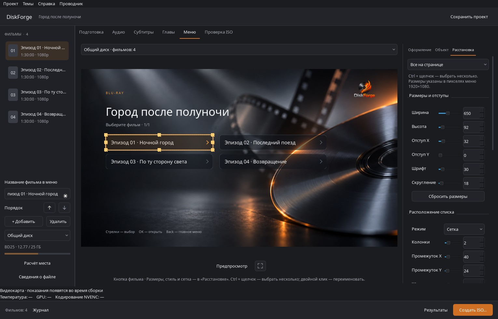

# Редактор кнопок списка эпизодов

Выберите кнопку на холсте и откройте «Расстановка». Панель работает и для глав фильма, и для каталога общего диска. Фон, заголовки, логотип и остальные объекты меню сохраняют свою композицию.

В обновлённой панели настройки разделены на «Размеры», «Стиль», «Сетка» и «Анимация». Над холстом находятся отмена, повтор, масштаб и направляющие. Маркеры размеров включаются инструментом R; V возвращает выбор и перемещение. [Новые снимки и управление](STUDIO_DESIGN.md).

## Размеры и оформление

Ползунки с числовым вводом задают ширину, высоту, отступы по двум осям, размер шрифта и скругление. Изменения сразу видны на холсте. Длинная подпись сокращается многоточием; размер текста ограничивается доступной высотой, стрелка остаётся внутри кнопки.

Область применения: выбранные кнопки, все на странице или все в проекте. Ctrl + щелчок выбирает несколько кнопок. Сброс размеров сохраняет положение и оформление. Если новый размер создаёт пересечение или не помещается в область списка, изменение отклоняется с объяснением.

Готовые стили: «Контурный», «Стеклянный», «Плашка», «Минималистичный». У каждого можно менять цвет фона, текста, рамки и выделения, прозрачность заливки, толщину контура и силу свечения. Свой пресет сохраняется вместе с проектом. Пресеты меняют только оформление: размеры, отступы, шрифт и расположение остаются независимыми.

## Расстановка и отмена

- **Одна колонка** и **Сетка** автоматически размещают кнопки по порядку, слева направо и сверху вниз. Доступны число колонок (1–8), горизонтальный и вертикальный интервалы, выравнивание и одинаковые размеры. Область списка ограничена 1620×540 внутри экрана 1920×1080, чтобы сохранить место для заголовков и подсказки.
- Перетащите кнопку внутри колонки или между колонками. Полупрозрачная копия следует за курсором, оранжевая линия отмечает место вставки, соседи плавно занимают новые места. Перетаскивание начинается после стандартного системного порога движения, поэтому обычный щелчок не меняет порядок.
- В **Свободном расположении** задаются координаты. Доступны шаг сетки и привязка к направляющим, границам и центрам соседних элементов; Alt временно отключает привязку. Пересечение кнопок при перемещении и изменении размера отклоняется.
- «Раньше» и «Позже» меняют порядок без мыши. «Отменить» и «Повторить», Ctrl+Z / Ctrl+Shift+Z / Ctrl+Y восстанавливают изменения. Всё перетаскивание считается одним действием. На macOS стандартная команда отмены использует Cmd+Z.

Снятие флажка «Одинаковые размеры» позволяет задавать размеры отдельных ячеек. Изменение размера только выбранной кнопки снимает этот флажок, сохраняя структуру сетки и размеры остальных кнопок.

## Состояния и анимация

«Без анимации» переключает состояния сразу. «Сдержанная» использует переходы за 180 мс и последовательное появление с задержкой 25 мс; «Кинематографичная» — 220 мс и 45 мс. Постоянных пульсаций нет: таймер останавливается после завершения перехода. Нажатие кратко приглушает подсветку. Стрелка и границы списка не смещаются.

Наведение мышью, клавиатура и пульт используют одно выделение с тёмной внешней линией, светлой внутренней кромкой и цветным акцентом. Флажок «Недоступная кнопка» оставляет кнопку видимой, но исключает её из навигации и запуска. Направления выбирают ближайшую доступную кнопку в соответствующей половине плоскости, в том числе между колонками.

В «Предпросмотре» перемещение и редактирование отключены. Мышь выделяет и активирует кнопки, клавиатура и экранный пульт используют ту же геометрию.

## Сохранение и Blu-ray

Проект хранит координаты, порядок, настройки сетки, размеры, оформление, пресеты и выбранный режим анимации. Старые проекты без `button_editor` сохраняют исходную геометрию до явного выбора нового режима расстановки.

Экспорт использует те же изображения и координаты, что и редактор. Недоступные кнопки остаются на изображении страницы, но для них не создаются активные области. Для выделения и нажатия создаются отдельные статичные изображения; нажатие показывает приглушённое выделение на 90 мс перед выполнением действия. BD-J поддерживает мышь при наличии указателя у проигрывателя и прежнее управление пультом. Перетаскивания в дисковом меню нет.

**Текущий растровый экспортёр DiskForge создаёт статичные страницы и изображения выделения.** Поэтому плавные переходы, появление и анимация перестановки остаются в предпросмотре; диск получает статичные состояния с теми же цветами, скруглением, заливкой, свечением и выделением. Ограничение указано в панели и окне экспорта. В `menu.properties` записываются `animation.mode=static` и запрошенный режим, а полные настройки остаются в `discforge-design.json` / `discforge-collection.json` внутри JAR.

Это ограничение реализации DiskForge, а не запрет стандарта: [официальное описание Oracle BD-J](https://www.oracle.com/technical-resources/articles/javabluray.html) описывает анимированные кнопки и переходы; [описание Blu-ray Disc Association](https://us.blu-raydisc.com/wp-content/uploads/sites/2/2019/09/bdj_gem_application_definition-15496.pdf) также описывает анимацию состояний HDMV. Эффекты нельзя считать совместимыми с диском только по их работе в Qt: для настоящей анимации на диске нужен отдельный экспортёр и испытания проигрывателей.

## Проверка

`python -m unittest discover -s tests -v` проверяет существующие сценарии и новые жесты, выбор нескольких кнопок, сохранение пресетов, отмену/повтор, коллизии, состояния, таймеры, координаты и ресурсы JAR. Синтетические MPLS в тестах не являются воспроизводимым фильмом.

`python tools/check_spatial_navigation.py --jdk /path/to/jdk --api /path/to/classes.zip` сравнивает Python с пересобранным BD-J: 4172 направленных перехода и 4418 попаданий указателя. Это проверка кода и метаданных; работа всех физических Blu-ray-плееров не подтверждена.

Скриншоты Windows с искусственными данными: [до](images/episode-buttons-before.jpg), [после](images/episode-buttons-after.jpg), [предпросмотр](images/episode-buttons-after-preview.jpg). Воспроизведение: `python tools/capture_episode_buttons.py --enhanced --output /path/to/episode-buttons-after.jpg`; для снимка старой версии передайте `--source /path/to/old-checkout` без `--enhanced`.
