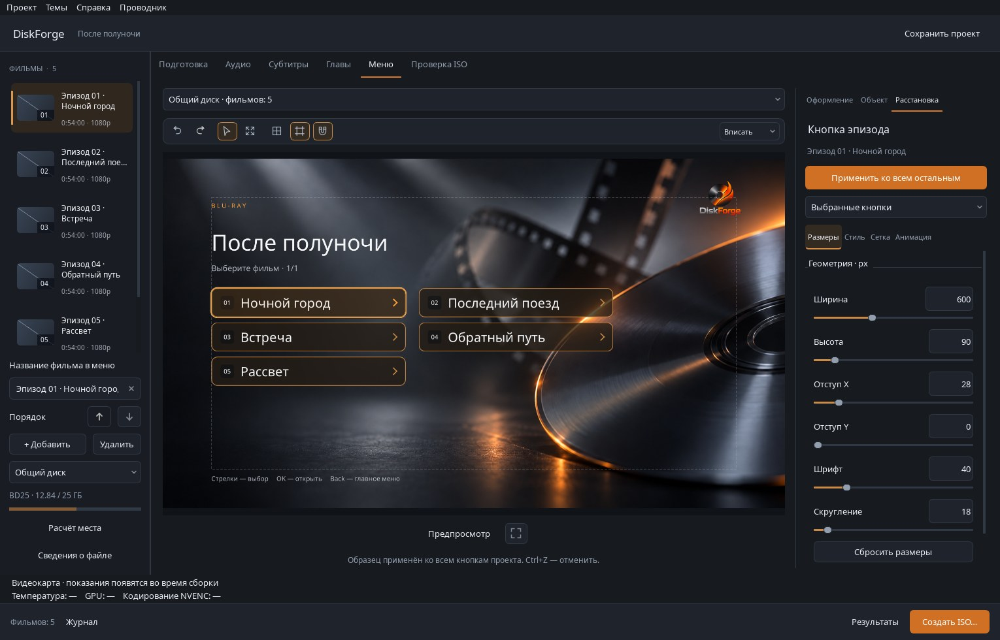
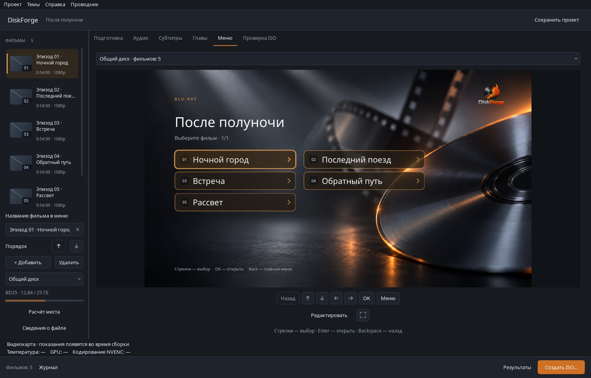
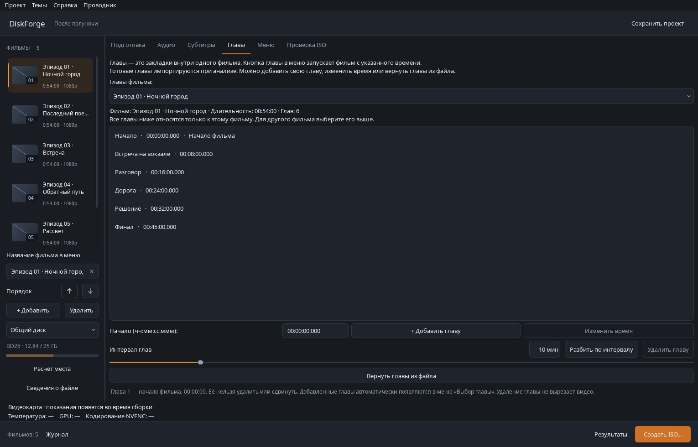

# DiskForge Studio 1.5.1 — единый стиль меню и проверка GIEC G2805

Полноценный выпуск для **Windows 10/11 x64** и **macOS Apple Silicon**. Редактор меню стал удобнее, оформление всех кнопок теперь можно настроить по одному образцу, а главы — переименовать прямо в списке.

**Физическая проверка диска на GIEC G2805 прошла успешно.** Автор проекта подтвердил результат и модель 9 ноября 2026 года. [Запись испытания](https://github.com/FORQO/DiscForge-RU/blob/main/docs/PLAYER_TEST_MATRIX.md).

## Что нового

- **Одна кнопка как образец для всего проекта.** Настройте её и нажмите «Применить ко всем остальным» в «Расстановке». Стиль, шрифт, размеры, внутренние отступы и равномерная сетка применяются ко всем фильмам, главам, звуку, субтитрам, собственным кнопкам и навигации. Подписи, действия и доступность сохраняются. Весь шаг отменяется одним Ctrl+Z; образец сохраняется в проекте и действует на других страницах и в меню остальных фильмов.
- **Обновлённая студия меню.** Четыре раздела свойств, карточки оформления, свои пресеты, инструменты холста, масштаб, направляющие, перенос между колонками и отмена/повтор. Библиотека показывает кадры и компактные сведения о фильмах.
- **Единые числовые настройки.** Слайдер и точное числовое поле используются для размеров, оформления, битрейта, интервала глав и параметров пробы качества. Маленькие системные стрелки убраны; сохранены диапазоны, дробная точность и единицы измерения.
- **Переименование глав в списке.** Двойной щелчок или F2 редактирует название, Enter сохраняет, Esc отменяет. Время задаётся отдельно. Названия сохраняются для каждого фильма и попадают в меню диска.
- **Удобная строка интервала глав.** Поле «10 мин» выровнено с кнопками разбиения и удаления.
- **Предпросмотр с учётом панели задач Windows.** Изображение и пульт помещаются в рабочей области экрана; элементы управления перестраиваются при небольшом окне и масштабировании.
- **Аккуратные детали интерфейса.** Строки видеокарты выровнены со временем сборки; значок очистки названия стал тонким, без круглой подложки, и расположен по центру поля.
- **Надёжная Windows-сборка.** Сборщик использует чистый путь поиска DLL, чтобы посторонние ICU/Qt-библиотеки из окружения не приводили к ошибке загрузки QtCore.
- **macOS:** SRT используют Noto Sans из комплекта приложения; создание ISO не зависит от установленного в системе OpenSans.

Сохранены BD25/BD50, одиночные фильмы и коллекции, аудио и субтитры, копирование совместимых потоков, пробы качества VMAF/SSIM, обработка отдельных фильмов, NVDEC/CUDA/NVENC на совместимой NVIDIA, кэш и возобновление сборки, проверка ISO и BD-J-навигация.

## Свежие скриншоты

Реальный интерфейс Windows с демонстрационным проектом; исходные фильмы в снимках демонстрационные.

[Светлая тема](https://raw.githubusercontent.com/FORQO/DiscForge-RU/main/docs/images/studio-1.5.1-light.jpg) · [План диска](https://raw.githubusercontent.com/FORQO/DiscForge-RU/main/docs/images/studio-1.5.1-plan.jpg).

## Проверки и достигнутый результат

- Полный локальный Windows-прогон: **636 тестов, без ошибок, 8 пропущены**. Дополнительно проверены применение общего образца, сохранение проекта, одна операция отмены и совпадение геометрии предпросмотра с экспортом.
- Обе темы и окна 1040×680 / 1380×850 проверены для числовых полей, глав, строки GPU и кнопки очистки названия. Упакованное Windows-приложение прошло **53 самопроверки**, включая применение образца и его отмену.
- Финальные Windows и macOS собираются из одного коммита после тестов. Сквозные сценарии проверяют Qt → FFmpeg → tsMuxer → BDMV/ISO: одиночный фильм и коллекцию, две аудиодорожки, текстовые субтитры, главы, меню, сохранение и открытие проекта. В Windows дополнительно проверяется BD-J через libVLC.
- **Успешная физическая проверка на GIEC G2805** подтверждена автором проекта. Прошивка, носитель и результаты отдельных пунктов пока не зафиксированы; другие модели требуют своих испытаний.

Вложения выпуска содержат Windows x64, macOS arm64, инструкции, отчёты самопроверок и сквозных сценариев, `SHA256SUMS.txt` и `release-manifest.json`. Манифест фиксирует точный исходный коммит, размер и SHA-256 каждого ZIP.

## Установка и обновление

**Windows:** распакуйте весь `DiskForge-Studio-1.5.1-Windows-x64.zip`, откройте папку `DiscForge_RU` и запустите `DiscForge_RU.exe`. Python, Qt, FFmpeg, tsMuxer и Java входят в комплект.

**macOS Apple Silicon:** распакуйте `DiskForge-Studio-1.5.1-macOS-arm64.zip` и перенесите `DiskForge.app` в «Программы». Приложение имеет локальную ad-hoc подпись, без нотарификации Apple. VLC устанавливается отдельно на обеих платформах.

Сохраните проект и закройте старую версию перед переходом. Прежние проекты поддерживаются; проекты с новым общим образцом кнопок открывайте в 1.5.1 и новее.

## Известные особенности

В VLC на macOS после окончания фильма окно может оставить последний кадр, хотя движок BD-J возвращается в меню, навигация и повторный запуск работают. Эта визуальная особенность остаётся известной; успешная проверка физического диска на GIEC G2805 не считается исправлением VLC на Mac.

Авторинг рассчитан на Full HD Blu-ray. HDR/UHD, Intel Mac, VideoToolbox и встроенная запись болванок не входят в этот выпуск. Переходы и появление кнопок анимируются в предпросмотре; текущий BD-J-экспорт сохраняет статичные состояния с тем же оформлением. Windows-пакет не подписан.
