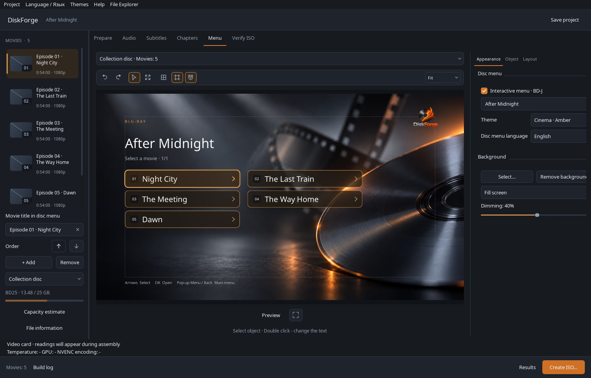
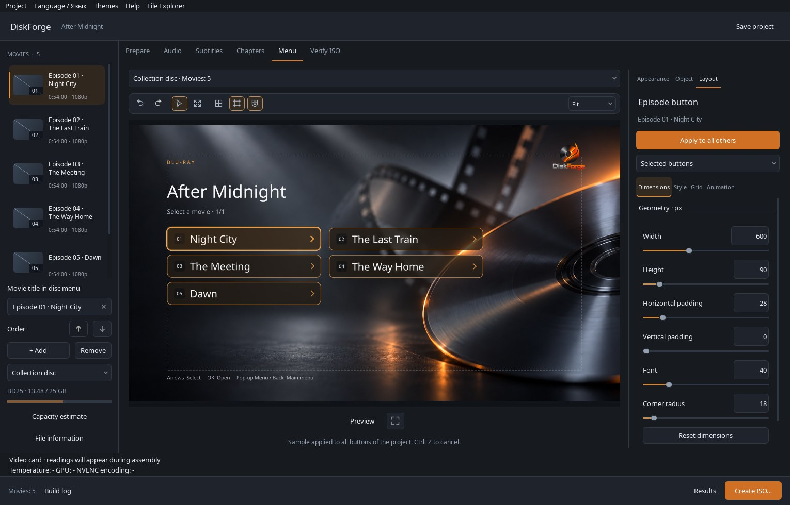
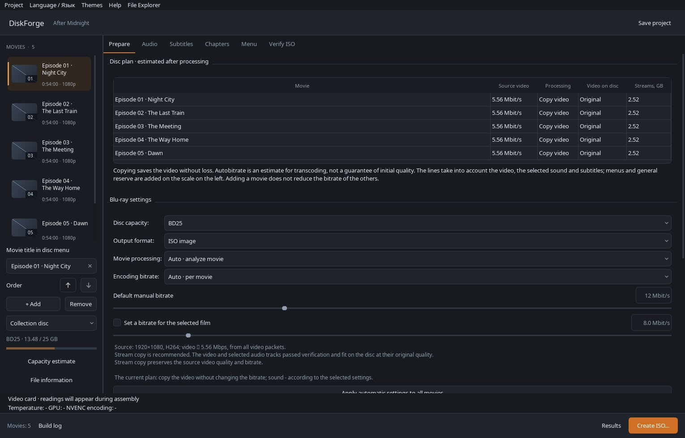
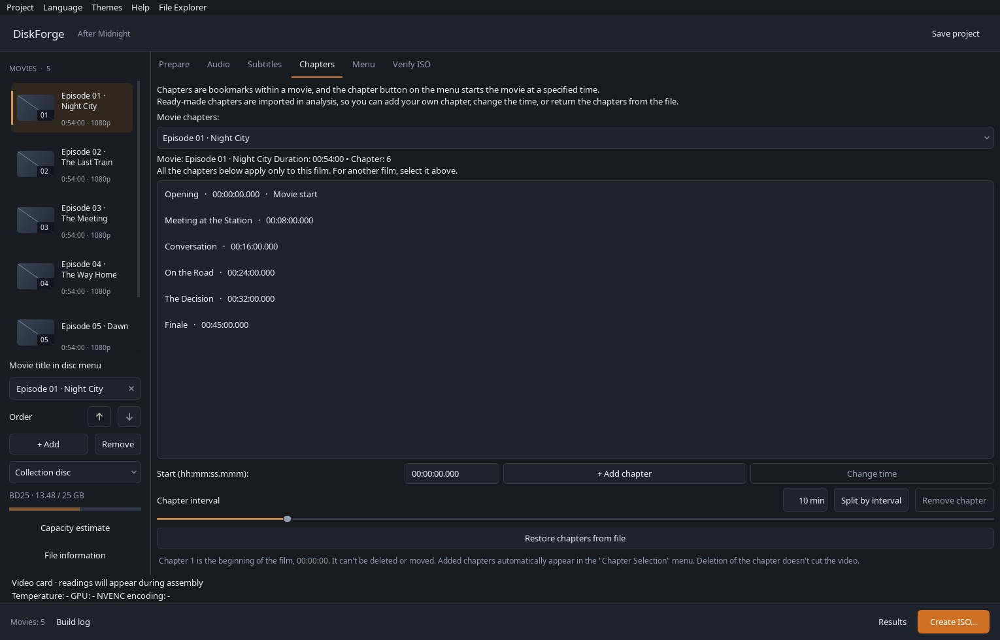
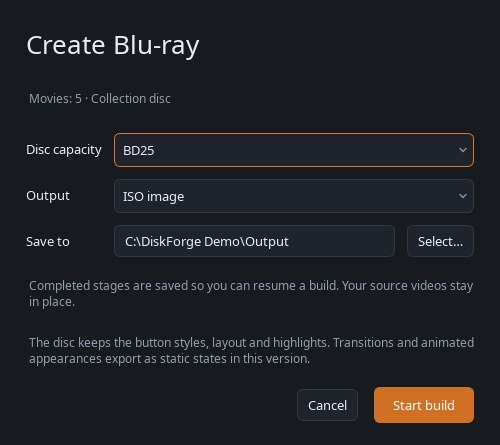

# DiskForge Studio 1.5.2

[Menu editor, themes and export · Studio 1.5.2 for Windows and macOS](https://github.com/FORQO/DiscForge-RU/blob/main/docs/STUDIO_EN.md#native-screenshots)

Снимки показывают английский интерфейс Studio 1.5.2 на Windows.

Единый интерфейс для Windows 10/11 x64 и macOS Apple Silicon. Основная ветка `main` содержит исходники обеих версий.

## Редактор меню

Слева — библиотека фильмов и заполнение диска. В центре — холст; справа — «Оформление», «Объект» и «Расстановка». Щелчок выбирает объект, двойной щелчок редактирует текст. При выборе объекта открываются его свойства.

## Светлая и тёмная темы

Тема приложения выбирается в меню «Темы», оформление меню диска настраивается отдельно.

## План диска и главы

В «Подготовке» видны обработка и объём каждого фильма. В «Главах» выбран конкретный фильм; тайминги и названия сохраняются в проекте.

## Предпросмотр и экспорт

«Предпросмотр» скрывает свойства и показывает пульт под изображением. «Редактировать» возвращает настройки. Журнал открывается кнопкой внизу и автоматически раскрывается при ошибке.

«Создать ISO…» открывает выбор носителя, ISO/BDMV и папки результата. «Начать сборку» запускает обработку.

Снимки сделаны в работающей Studio 1.5.2 на Windows. Нативные снимки для обеих платформ доступны в английском руководстве.

[Windows: скачать и запустить](WINDOWS_STUDIO.md) · [macOS: скачать и запустить](MACOS.md) · [Руководство](USER_GUIDE.md).
