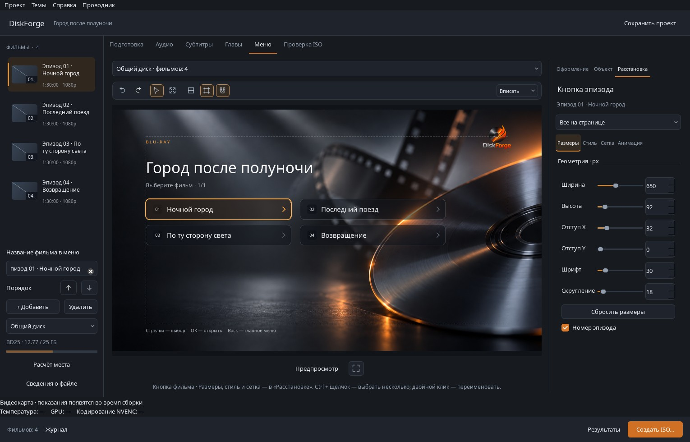
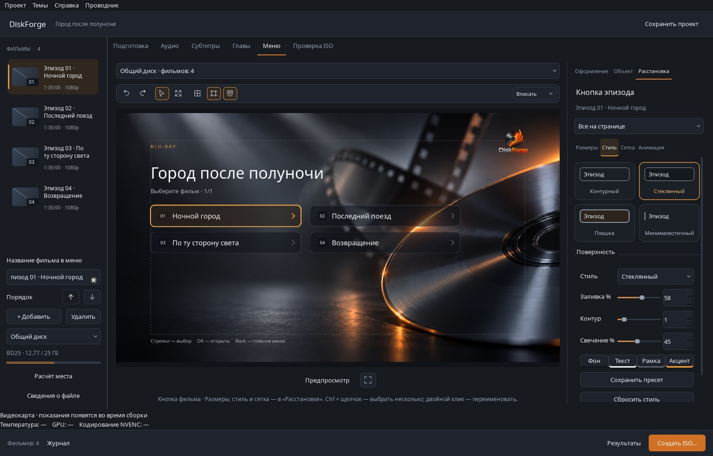
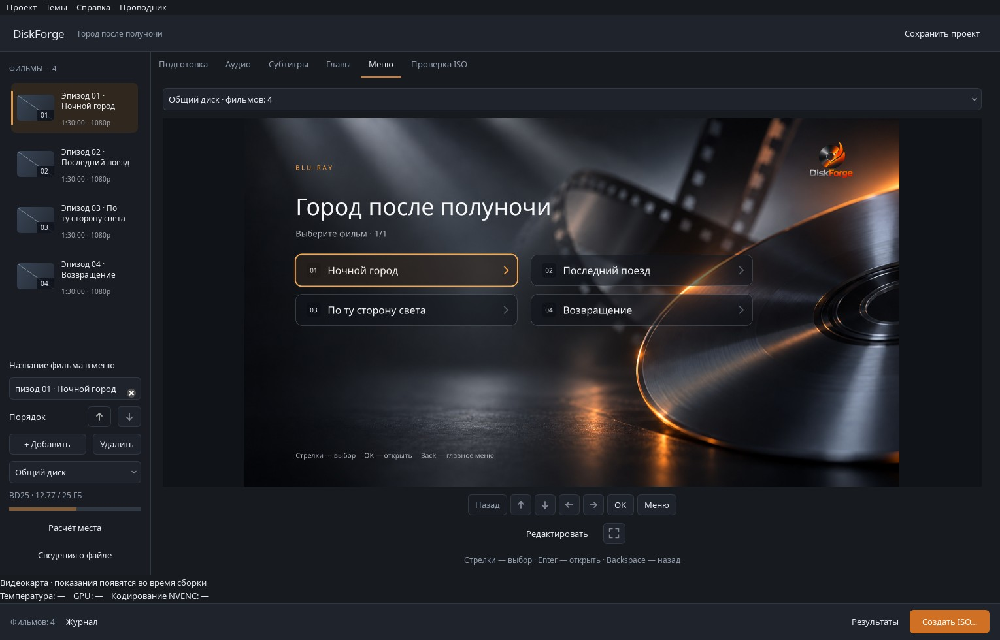

# Обновлённая студия меню

Тёмные поверхности, спокойные янтарные акценты и крупный холст сохранены. Свойства кнопок распределены по четырём разделам, а основные инструменты доступны над холстом.

## Свойства кнопки

Выберите кнопку на холсте. В «Расстановке» сверху видны выбранная кнопка и область применения: выбранные, страница или проект. Ctrl + щелчок выбирает несколько кнопок.

- **Размеры** — ширина, высота, внутренние отступы, шрифт, скругление и отдельный номер эпизода.
- **Стиль** — четыре наглядные карточки оформления, пресеты, палитра, прозрачность, контур и свечение. Карточки используют тот же рендерер, что и меню диска; выбранный стиль можно менять мышью и клавиатурой.
- **Сетка** — свободное размещение, колонка или сетка, интервалы и выравнивание. Дополнительные инструменты раскрываются отдельно.
- **Анимация** — без анимации, сдержанная или кинематографичная. Ограничения растрового BD-J-экспорта показаны в этом разделе и перед сборкой.

Панель проверена при размерах окна 1040×680 и 1380×850: поля и карточки помещаются по ширине, длинные разделы прокручиваются вертикально.

## Холст

Постоянная панель над изображением содержит отмену/повтор, выбор и перемещение, изменение размера, сетку, направляющие, привязку и масштаб.

| Действие | Управление |
| --- | --- |
| Выбрать и переместить объект | V или инструмент со стрелкой |
| Показать маркеры изменения размера | R или инструмент изменения размера |
| Масштабировать | «Вписать», 75–200%, либо Ctrl + колесо мыши |
| Переместить увеличенный холст | Средняя кнопка мыши |
| Отменить / повторить | Панель инструментов, Ctrl+Z / Ctrl+Shift+Z / Ctrl+Y |
| Показать сетку и безопасную область | Независимые кнопки панели |

Маркеры размера появляются только в соответствующем режиме. При наведении на кнопку виден компактный знак перетаскивания. В «Предпросмотре» изображение вписывается целиком; при возвращении к редактированию восстанавливается прежний масштаб. Инструменты холста не изменяют координаты объектов и не добавляются в экспорт.

## Кнопки меню

Номер эпизода отделён от названия небольшой тёмной плашкой. Для глав и каталога он определяется автоматически; явно указанные «Эпизод 03», «Серия 03» и аналогичные префиксы показываются в плашке. Исходная подпись сохраняется полностью и остаётся доступна для редактирования. Отдельный номер можно отключить.

Длинный текст ограничен своей областью, стрелка остаётся справа. Подсветка фокуса стала мягче; тёмная внешняя линия и светлая внутренняя кромка сохраняют различимость на разных участках фона. Превью и BD-J используют одинаковый рендерер и координаты.

## Библиотека

Строки библиотеки содержат компактный кадр, номер, название в две строки, длительность и разрешение. Выбранный фильм выделен янтарной полосой слева. При добавлении видео миниатюры извлекаются в фоне, максимум два одновременно, с ограничением времени обработки. Изображения хранятся в памяти; исходные видео и проект не переписываются. Если кадр недоступен, показывается нейтральная заглушка.

Снимки получены на Windows с демонстрационными названиями; исходные фильмы в репозиторий не включены. Для повторения: `python tools/capture_episode_buttons.py --enhanced --output /path/to/studio-design.jpg`.

Проверки: `python -m unittest discover -s tests -v`. Отдельный набор `test_studio_design.py` проверяет размещение панели, переключение инструментов, масштабирование, применение карточек, сохранение исходной подписи, совпадение изображения каталога при экспорте и работу фоновых запросов миниатюр. Физические Blu-ray-проигрыватели этим не проверяются.
