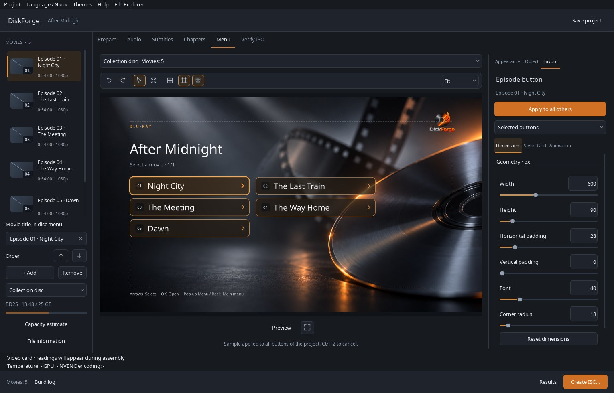
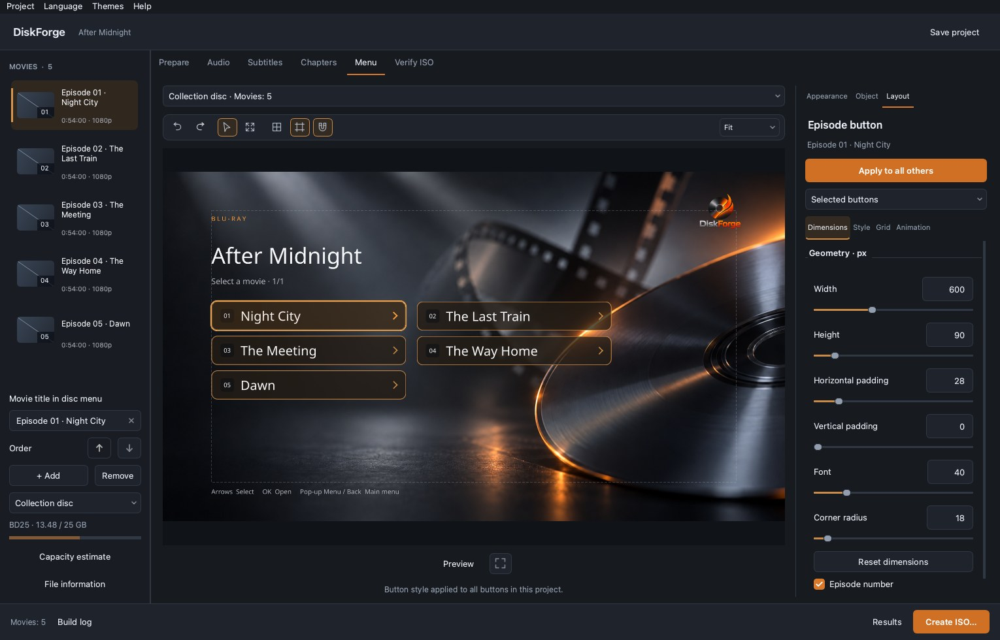

# DiskForge Studio in English

DiskForge turns video files into a Blu-ray ISO or BDMV folder. Build a collection with a shared menu, or create a separate disc for each movie.

## Install Studio 1.5.2

- **Windows 10/11 x64.** Download the Windows ZIP and extract it in full. Run `DiscForge_RU.exe` from the extracted folder. Keep its accompanying tools and runtime together. [Windows download](https://github.com/FORQO/DiscForge-RU/releases/download/v1.5.2-studio/DiskForge-Studio-1.5.2-Windows-x64.zip)
- **macOS on Apple Silicon.** Download and unzip the Mac build. Move `DiskForge.app` into Applications. macOS may ask you to approve this ad-hoc-signed app in System Settings → Privacy & Security. [macOS download](https://github.com/FORQO/DiscForge-RU/releases/download/v1.5.2-studio/DiskForge-Studio-1.5.2-macOS-arm64.zip)

## Create a disc

1. Open **Language / Язык** to choose **English**, **Русский** or **Use system language**. Restart Studio after changing this setting. New installations follow the system and default to English on non-Russian systems.
2. Add videos or drop them into the window. After analysis, open **Prepare** to choose a collection disc or separate discs, disc capacity and video processing. Check the estimated size before exporting.
3. Select the audio and subtitle tracks you want on the disc. In **Chapters**, edit the names and timing for each movie.
4. Open **Menu** to style the disc menu and preview it with the remote. **Appearance → Disc menu language** controls the labels on the disc. Movie titles and your own labels keep their original text.
5. Choose **Create ISO…**, select ISO or BDMV and an output folder, then choose **Start build**. Use **Verify ISO** to check the result. Install VLC separately to preview playback.

## Native screenshots

The screenshots show Studio 1.5.2 running on Windows and macOS with English selected and a fictional collection called *After Midnight*. Downloads contain the complete native gallery for each platform. [Windows gallery ZIP](https://github.com/FORQO/DiscForge-RU/releases/download/v1.5.2-studio/DiskForge-Studio-1.5.2-gallery-Windows.zip) · [macOS gallery ZIP](https://github.com/FORQO/DiscForge-RU/releases/download/v1.5.2-studio/DiskForge-Studio-1.5.2-gallery-macOS.zip)

| Screen | Windows x64 | macOS Apple Silicon |
| --- | --- | --- |
| Welcome | [Windows](images/studio-1.5.2/windows/welcome.jpg) | [macOS](images/studio-1.5.2/macos/welcome.jpg) |
| Disc plan | [Windows](images/studio-1.5.2/windows/plan.jpg) | [macOS](images/studio-1.5.2/macos/plan.jpg) |
| Audio track selection | [Windows](images/studio-1.5.2/windows/audio.jpg) | [macOS](images/studio-1.5.2/macos/audio.jpg) |
| Subtitles | [Windows](images/studio-1.5.2/windows/subtitles.jpg) | [macOS](images/studio-1.5.2/macos/subtitles.jpg) |
| Chapter editor | [Windows](images/studio-1.5.2/windows/chapters.jpg) | [macOS](images/studio-1.5.2/macos/chapters.jpg) |
| Button layout | [Windows](images/studio-1.5.2/windows/menu.jpg) | [macOS](images/studio-1.5.2/macos/menu.jpg) |
| Menu appearance | [Windows](images/studio-1.5.2/windows/appearance.jpg) | [macOS](images/studio-1.5.2/macos/appearance.jpg) |
| Selected menu object | [Windows](images/studio-1.5.2/windows/object.jpg) | [macOS](images/studio-1.5.2/macos/object.jpg) |
| Light theme | [Windows](images/studio-1.5.2/windows/light.jpg) | [macOS](images/studio-1.5.2/macos/light.jpg) |
| Remote-control preview | [Windows](images/studio-1.5.2/windows/preview.jpg) | [macOS](images/studio-1.5.2/macos/preview.jpg) |
| Verify and burn ISO | [Windows](images/studio-1.5.2/windows/verify-iso.jpg) | [macOS](images/studio-1.5.2/macos/verify-iso.jpg) |
| Export disc | [Windows](images/studio-1.5.2/windows/export.jpg) | [macOS](images/studio-1.5.2/macos/export.jpg) |
| Encoding quality samples | [Windows](images/studio-1.5.2/windows/quality.jpg) | [macOS](images/studio-1.5.2/macos/quality.jpg) |

[Release notes](https://github.com/FORQO/DiscForge-RU/releases/tag/v1.5.2-studio) · [Русская документация](README.md)
